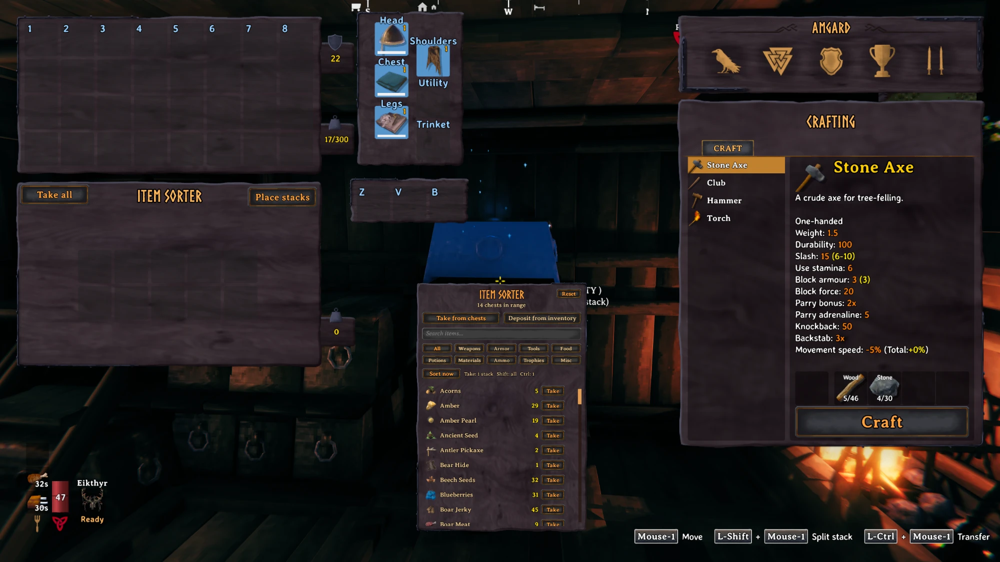
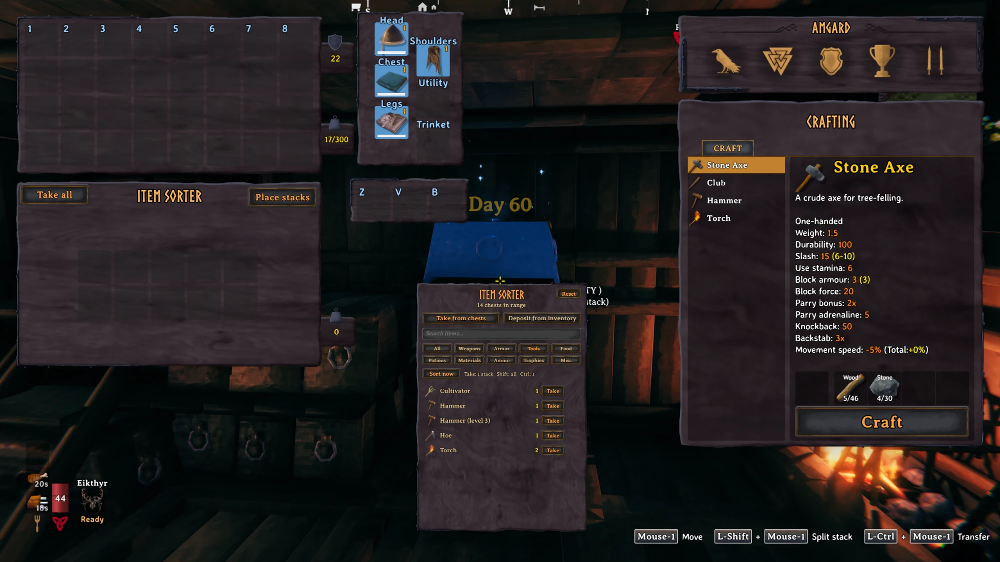
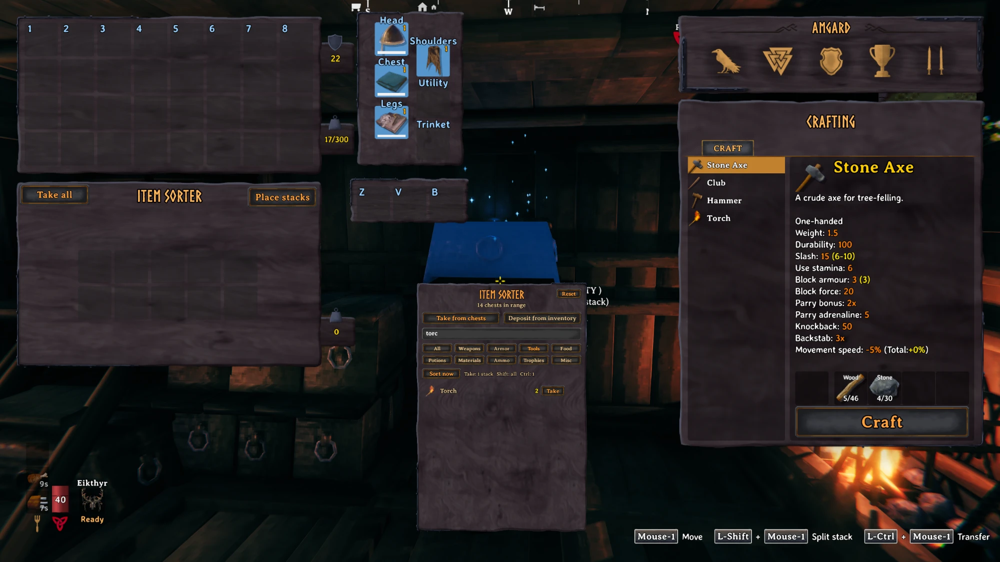

# Mímir's Vault

Magical storage for Valheim by **Amgard**: an Item Sorter that keeps your chests in order and a
Smelter Box that runs your smelters for you.

## Screenshots

**The Item Sorter window** – every item in the chests around you, summed up and in alphabetical order.
Take a stack, everything (Shift) or just one (Ctrl).

**Category filters** – one click shows only Tools, Food, Weapons, Armor, Materials and more.

**Search** – type part of a name to find it across all your chests.

Adds an **Item Sorter** to the Hammer (Furniture tab): a glowing light-blue chest with floating
sparkles. Cost: 10 Wood, 10 Thistle, 5 Greydwarf eyes.

## Sorting
Open the sorter and drop items into it. Half a second later every item is moved into the
nearby chests (default 20 m):

1. Chests that **already contain that item** first: existing stacks are topped up to their max stack size.
2. If those stacks are full, the rest goes into an empty slot of the same chest (`UseEmptySlots`).
3. Items no chest holds yet get a new slot in the chest holding the most items of the same type
   (materials with materials, food with food, ...) (`PlaceNewItems`).
4. New stacks are placed in the free slot next to similar items (`GroupSimilarItems`).

## Depositing from your inventory
Switch to the **Deposit from inventory** tab, click the items you want to put away (Shift+click
selects everything shown) and press **Sort selected**. Equipped gear is never touched. Anything
that finds no chest goes into the sorter.

Only chests you built and are allowed to open are used (no graves, carts, ships, dungeon chests,
warded chests you lack access to, or chests another player has open).

## Taking items
While the sorter is open, a Valheim-styled window lists every item in all chests in range,
summed up, in alphabetical order. Type in **Search** or pick a category (Weapons, Armor, Tools,
Food, Potions, Materials, Ammo, Trophies, Misc) to filter. Drag the window by its background to
move it; it remembers where you put it, and **Reset** puts it back next to the crafting panel.

- **Take** – one full stack
- **Shift + Take** – everything
- **Ctrl + Take** – just one

## Smelter Box
A crimson Reinforced chest that glows like hot coals, with rising embers and a flickering forge light.
Build it near a **Forge** for 5 Fine wood, 5 Core wood, 5 Greydwarf eyes, 5 Bronze nails and 2 Surtling cores.

- **Feeds smelters:** put in wood, coal, copper, tin, iron, ... and every second it adds one ore and one
  fuel to each smelter, blast furnace, kiln, windmill, spinning wheel or eitr refinery within 10 m.
  Whatever doesn't fit stays in the box.
- **Catches output:** finished bars, coal, flour, ... go into the nearest Smelter Box with room. When that box
  is full the next one is used, and only when every box is full does the output drop on the ground.
- Kiln coal lands in the box and is then fed to the smelters as fuel.
- Fine wood, Core wood and other valuable wood are never fed into the kiln (`NeverFeed`).
- The glow and embers get stronger while a smelter in range is working.

## Config
`BepInEx/config/Amgard.MimirsVault.cfg` (or r2modman's Config editor): `Radius`, `UseEmptySlots`,
`PlaceNewItems`, `GroupSimilarItems`, `SortDelay`; under SmelterBox `Radius`, `FeedInterval`, `NeverFeed`,
`CatchOutput`; under Visuals `Sparkles` and `Glow`.

## AI disclosure
This mod was created with the assistance of generative AI. Its code was written with
**Claude Opus 5.5 (Anthropic)**, then reviewed and tested in game by the author. The icon was
made with an AI image generator.
The assembly carries the matching `AI_Assisted_Creation` / `AI_Model_Vendor` metadata.

## Multiplayer
Every player (and a dedicated server) needs the mod. The sorter takes ownership of chests
before changing them, and skips chests other players have open.
